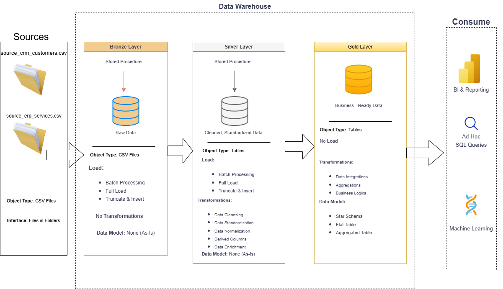
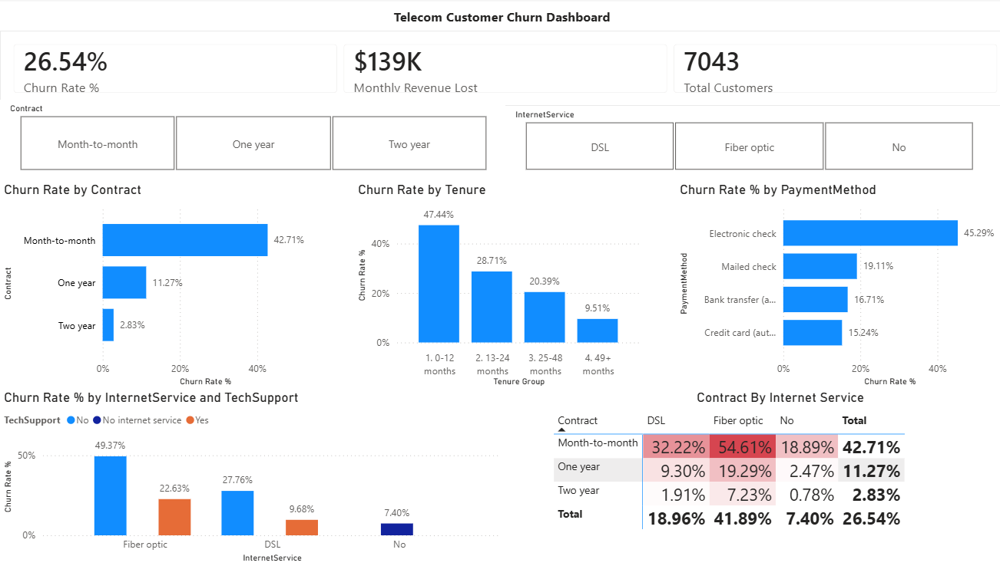

# Telecom Customer Churn Data Warehouse

An end-to-end data warehouse built with SQL Server using the Medallion Architecture (Bronze/Silver/Gold), followed by SQL analysis and a Power BI dashboard to understand why telecom customers leave. 

**Headline finding:** Month-to-month customers on fiber optic make up 30% of customers but account for 62% of all churn.
 
**Tools:** SQL Server 2022 · T-SQL · SSMS · Power BI

---


## Data Architecture
The project follows the Medallion Architecture with Bronze, Silver, and Gold layers:

1. **Bronze Layer**: Stores raw data as-is from the source systems. Data is ingested from CSV files into SQL Server using BULK INSERT.
2. **Silver Layer**: Includes data cleansing, standardization, and deduplication processes to prepare data for analysis.
3. **Gold Layer**: Houses business-ready data modelled into a star schema optimized for reporting and analytics.

## Project Overview
This project involves:

1. **Data Architecture**: Designing a modern data warehouse using Medallion Architecture.
2. **ETL Pipelines**: Extracting, transforming, and loading data from two source systems into the warehouse.
3. **Data Modeling**: Developing fact and dimension tables optimized for analytical queries.
4. **Analytics & Reporting**: Building a star schema that enables business analysts to answer key churn questions and visualizing the results in Power BI.

## Business Questions & Findings
 
All findings come from SQL queries run on the Gold layer. The full queries are in [`Scripts/analysis/analysis_queries.sql`](Scripts/analysis/analysis_queries.sql).
 
### Key numbers
 
| Metric | Result |
|--------|--------|
| Total customers | 7,043 |
| Churned customers | 1,869 |
| **Overall churn rate** | **26.54%** |
| Monthly revenue lost to churn | ~$139,131 |
 
### 1. Which contract type churns the most?
 
| Contract | Customers | Churn rate |
|----------|-----------|------------|
| Month-to-month | 3,875 | **42.71%** |
| One year | 1,473 | 11.27% |
| Two year | 1,695 | 2.83% |
 
**Finding:** Month-to-month customers churn about 15 times more often than two-year customers. They make up 55% of the customer base but account for about 89% of all churned customers.
 
### 2. Are new customers more likely to leave?
 
| Tenure | Customers | Churn rate |
|--------|-----------|------------|
| 0-12 months | 2,186 | **47.44%** |
| 13-24 months | 1,024 | 28.71% |
| 25-48 months | 1,594 | 20.39% |
| 49+ months | 2,239 | 9.51% |
 
**Finding:** Nearly half of customers in their first year leave. Churn drops steadily with tenure, and long-term customers churn about five times less than new ones.
 
### 3. Does tech support or internet type affect churn?
 
| Internet | Tech support | Customers | Churn rate |
|----------|--------------|-----------|------------|
| Fiber optic | No | 2,230 | **49.37%** |
| Fiber optic | Yes | 866 | 22.63% |
| DSL | No | 1,243 | 27.76% |
| DSL | Yes | 1,178 | 9.68% |
| No internet | n/a | 1,526 | 7.40% |
 
**Finding:** Customers with tech support churn far less within both internet types. Fiber optic customers without tech support are at the highest risk, at nearly 1 in 2.
 
### 4. How much revenue is lost to churn?
 
| Contract | Monthly revenue lost | Share of total loss |
|----------|---------------------|---------------------|
| Month-to-month | $120,847 | **86.86%** |
| One year | $14,118 | 10.15% |
| Two year | $4,165 | 2.99% |
 
**Finding:** Month-to-month customers account for almost 87% of the monthly revenue lost to churn.
 
### 5. Which payment methods have the highest churn?
 
| Rank | Payment method | Customers | Churn rate |
|------|----------------|-----------|------------|
| 1 | Electronic check | 2,365 | **45.29%** |
| 2 | Mailed check | 1,612 | 19.11% |
| 3 | Bank transfer (automatic) | 1,544 | 16.71% |
| 4 | Credit card (automatic) | 1,522 | 15.24% |
 
**Finding:** Electronic check users churn about three times more than customers on automatic payments (credit card or bank transfer). Automatic payment methods have the lowest churn.
 
### 6. Do demographics matter?
 
| Attribute | Value | Customers | Churn rate |
|-----------|-------|-----------|------------|
| Senior citizen | Yes | 1,142 | **41.68%** |
| Senior citizen | No | 5,901 | 23.61% |
| Partner | Yes | 3,402 | 19.66% |
| Partner | No | 3,641 | 32.96% |
| Dependents | Yes | 2,110 | 15.45% |
| Dependents | No | 4,933 | 31.28% |
 
**Finding:** Senior citizens churn at nearly twice the rate of other customers. Customers with a partner or dependents are noticeably more likely to stay.
 
### 7. Which customer segments are the highest risk?
 
A segment is a contract + internet service combination (segments under 100 customers excluded).
 
| Rank | Contract | Internet | Customers | Churned | Churn rate | Avg monthly charge |
|------|----------|----------|-----------|---------|------------|--------------------|
| 1 | Month-to-month | Fiber optic | 2,128 | 1,162 | **54.61%** | $87.02 |
| 2 | Month-to-month | DSL | 1,223 | 394 | 32.22% | $50.22 |
| 3 | One year | Fiber optic | 539 | 104 | 19.29% | $98.78 |
| 4 | Month-to-month | No internet | 524 | 99 | 18.89% | $20.41 |
| 5 | One year | DSL | 570 | 53 | 9.30% | $61.40 |
| 6 | Two year | Fiber optic | 429 | 31 | 7.23% | $104.57 |
| 7 | One year | No internet | 364 | 9 | 2.47% | $20.82 |
| 8 | Two year | DSL | 628 | 12 | 1.91% | $70.46 |
| 9 | Two year | No internet | 638 | 5 | 0.78% | $21.78 |
 
**Finding:** Month-to-month fiber optic customers are the single riskiest group. They are 30% of all customers but 62% of all churn (1,162 of 1,869), and they pay a high average monthly charge, so each loss costs the most.
 
---
 
## Recommendations
 
1. **Target month-to-month fiber optic customers first.** This one segment drives most of the churn. Offer a discount or incentive to move them to a one-year plan.
2. **Focus on the first 12 months.** Nearly half of new customers leave in year one. Add onboarding, check-ins, and early loyalty offers.
3. **Bundle tech support.** Offer a free trial of tech support, especially for fiber customers, where the churn gap is largest.
4. **Encourage automatic payments.** Offer a small bill credit for switching from electronic check to autopay, since autopay customers churn far less.
5. **Create a plan for senior customers.** Their churn rate is almost double. Simpler plans or dedicated support could help.
6. **Investigate fiber optic service.** Churn is high even for fiber customers with tech support, which suggests a possible price or quality problem worth exploring.

## Limitations
 
- This analysis shows **associations, not causes**. For example, customers with tech support may differ in other ways, and an A/B test would be needed to prove that offering support *reduces* churn.
- Some factors overlap. Electronic check users may also tend to be on month-to-month contracts, so part of the payment-method effect could really be a contract effect. A deeper analysis could separate them.
- Results are based on a single snapshot of 7,043 customers.
---

## Dashboard


**Key takeaways (all values validated against the SQL analysis):**

- Overall churn is **26.54%**, costing roughly **$139K in monthly revenue**.
- **Contract type is the strongest driver:** month-to-month customers churn at 42.71%, versus 2.83% on two-year contracts.
- **The first year is the danger zone:** 47.44% of customers with 0-12 months of tenure leave, versus 9.51% after 49+ months.
- **Payment method matters:** electronic check users churn at 45.29%, about three times the rate of customers on automatic payments.
- **Tech support helps:** fiber customers without it churn at 49.37% (22.63% with it), and DSL customers at 27.76% (9.68% with it).
- **The riskiest segment** is month-to-month fiber optic customers, at 54.61%.

Use the Contract and Internet service slicers to explore any segment.

## How to Run

### Prerequisites
- SQL Server 2022
- SSMS
- CSV files placed at `C:\TelecomChurn\Datasets\`

### Steps

**1. Create database and schemas**
```sql
CREATE DATABASE TelecomChurn;
USE TelecomChurn;
CREATE SCHEMA bronze;
CREATE SCHEMA silver;
CREATE SCHEMA gold;
```

**2. Run scripts in this order:**
```
scripts/bronze/ddl_bronze.sql
scripts/bronze/proc_load_bronze.sql  → EXEC bronze.load_bronze;
scripts/silver/ddl_silver.sql
scripts/silver/proc_load_silver.sql  → EXEC silver.load_silver;
scripts/gold/ddl_gold.sql
```
---

```
Telecom-Churn-Data-Warehouse/
├── Datasets/
│   ├── source_crm_customers.csv
│   └── source_erp_services.csv
├── Docs/
│   ├── Data_Architecture.drawio.png
│   └── PowerBI Dash New.png
├── Scripts/
│   ├── bronze/
│   │   ├── ddl_bronze.sql
│   │   └── proc_load_bronze.sql
│   ├── silver/
│   │   ├── ddl_silver.sql
│   │   └── proc_load_silver.sql
│   ├── gold/
│   │   └── ddl_gold.sql
│   └── analysis/
│       └── analysis_queries.sql
├── LICENSE
└── README.md
```
## Skills Demonstrated
 
- Data warehouse design (Medallion Architecture, star schema)
- ETL with T-SQL (`BULK INSERT`, stored procedures, data cleansing)
- Analytical SQL (JOINs, aggregation, `CASE`, CTEs, window functions, `UNION ALL`)
- Data visualization with Power BI
- Turning data into business recommendations
